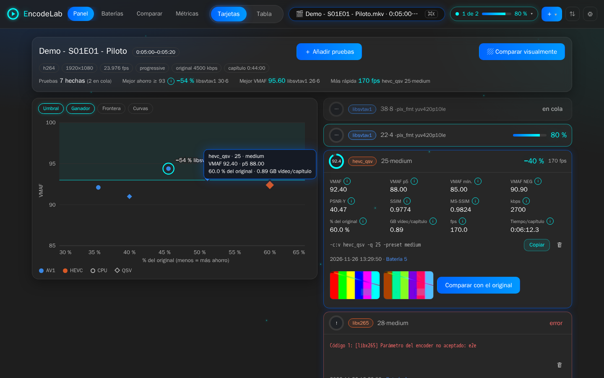
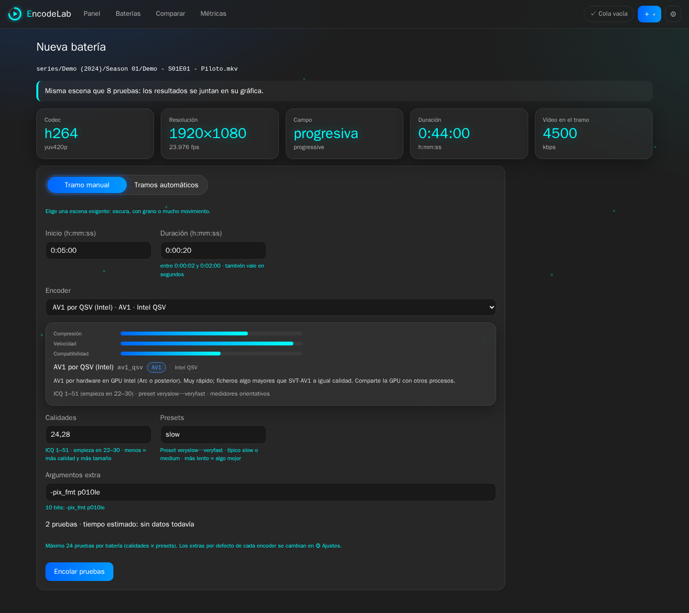
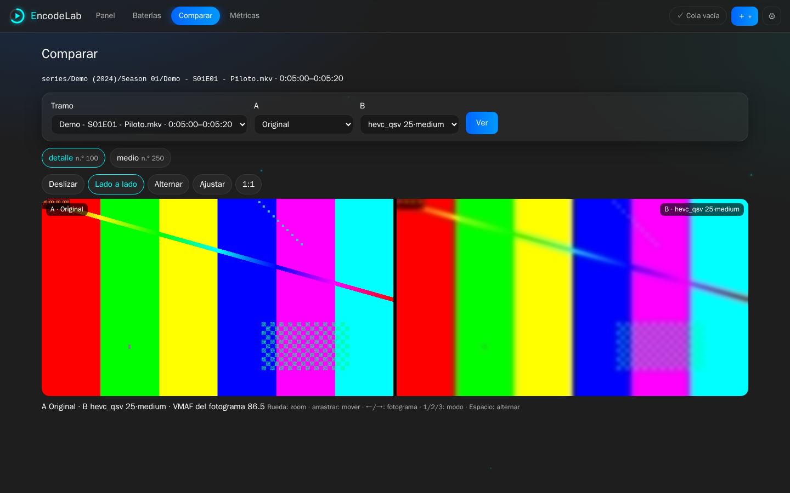

# EncodeLab

Banco de pruebas de codificación de vídeo: codifica tramos cortos de tus vídeos con distintos encoders, calidades y
presets, y mide el resultado con **VMAF**, **PSNR**, **SSIM** y **MS-SSIM** para elegir los ajustes de transcodificación
con datos, no a ojo.

- Encoders: **SVT-AV1** y **x265** por CPU, y **AV1/HEVC por Intel QSV** si hay GPU Intel compatible.
- Gráfica calidad/tamaño, estimación de tamaño y tiempo por capítulo, y comparador visual de fotogramas.
- Tramos automáticos: busca las escenas más exigentes del episodio.
- Flask + SQLite, ffmpeg estático con libvmaf. Interfaz en castellano.



| Nueva batería | Comparador |
|---|---|
|  |  |

## Requisitos

- Linux x86-64 con Docker y Docker Compose v2.
- Opcional: GPU Intel con QSV (Arc o iGPU reciente) y el grupo `render` en el host.
  Sin GPU funciona solo con CPU; la app detecta al arrancar qué encoders QSV funcionan y oculta el resto.

## Instalación rápida

```sh
mkdir encodelab && cd encodelab
curl -LO https://raw.githubusercontent.com/Adrian-Gonzalez-E/encodelab/main/compose.yaml
curl -L -o .env https://raw.githubusercontent.com/Adrian-Gonzalez-E/encodelab/main/.env.example
mkdir data            # antes del primer arranque: si lo crea Docker, será de root y la app no podrá escribir
$EDITOR .env          # como mínimo MEDIA_PATH; PUID/PGID = la salida de `id`
docker compose up -d
```

Abre <http://127.0.0.1:8080>.

### Con GPU Intel (QSV)

```sh
curl -LO https://raw.githubusercontent.com/Adrian-Gonzalez-E/encodelab/main/compose.qsv.yaml
echo "RENDER_GID=$(getent group render | cut -d: -f3)" >> .env
docker compose -f compose.yaml -f compose.qsv.yaml up -d
```

Si tienes varias GPU, indica en `QSV_DEVICE` el nodo de la Intel que quieras usar (`ls -l /dev/dri/by-path/`).
En ⚙ Ajustes → Sistema verás qué encoders QSV están disponibles o por qué no.

### Variables (`.env`)

| Variable | Por defecto | Uso |
|---|---|---|
| `MEDIA_PATH` | (obligatoria) | Directorio con tus vídeos, montado en solo lectura |
| `DATA_PATH` | `./data` | Base de datos y fotogramas de comparación |
| `PUID` / `PGID` | `1000` | Usuario y grupo de la app |
| `TZ` | `Etc/UTC` | Zona horaria |
| `PORT` | `8080` | Puerto en `127.0.0.1` |
| `VMAF_THREADS` | todas las CPU | Hilos de libvmaf |
| `ENCODELAB_TAG` | `latest` | Versión de la imagen |
| `RENDER_GID` | | GID del grupo `render` (solo QSV) |
| `QSV_DEVICE` | `/dev/dri/renderD128` | Nodo de la GPU Intel (solo QSV) |

## Seguridad

La app **no tiene login**. Por eso el compose publica el puerto solo en `127.0.0.1`. Para usarla desde otro equipo,
ponla detrás de un proxy inverso con autenticación (y quita `ports:`). Los POST que el navegador marca como de otro sitio (`Sec-Fetch-Site`) se rechazan.

## Desarrollo

```sh
git clone https://github.com/Adrian-Gonzalez-E/encodelab.git && cd encodelab
docker build -t ghcr.io/adrian-gonzalez-e/encodelab:dev app
docker run --rm -u 1000:1000 ghcr.io/adrian-gonzalez-e/encodelab:dev python3 -m pytest -q -p no:cacheprovider tests
app/e2e/run.sh [directorio de capturas]   # pruebas de interfaz con Playwright (usa la imagen :dev)
```

Hoja de ruta: más encoders como módulos (NVENC, VAAPI/AMD) e interfaz en inglés.

## Licencia

AGPL-3.0, ver [LICENSE](LICENSE). Si ofreces una versión modificada como servicio, debes publicar su código.
La imagen incluye ffmpeg estático GPL de [BtbN/FFmpeg-Builds](https://github.com/BtbN/FFmpeg-Builds), que publica su código fuente.
